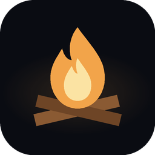
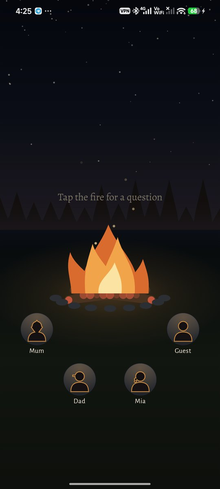
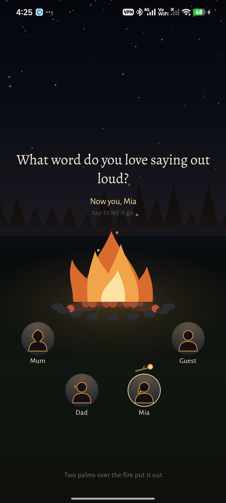
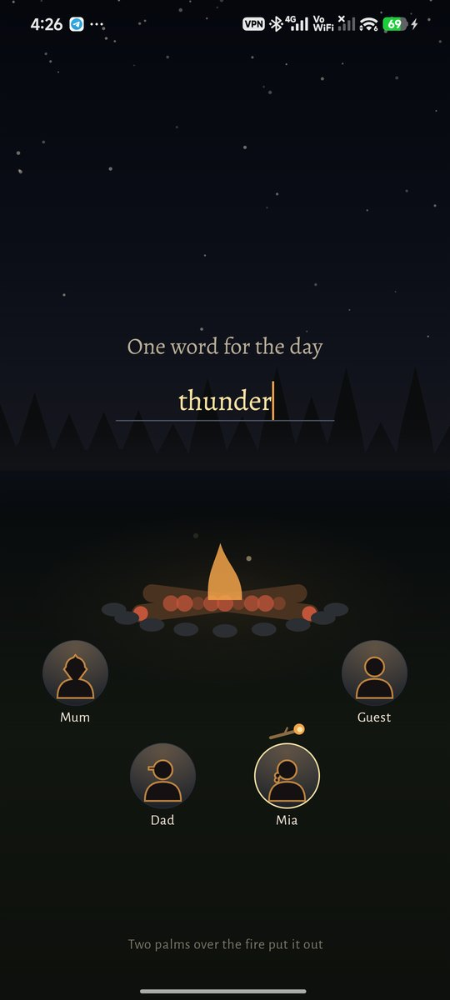
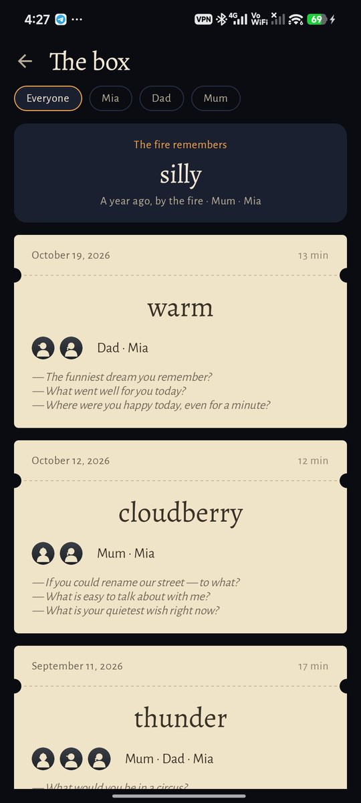
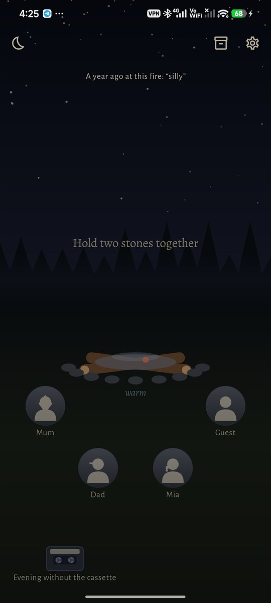
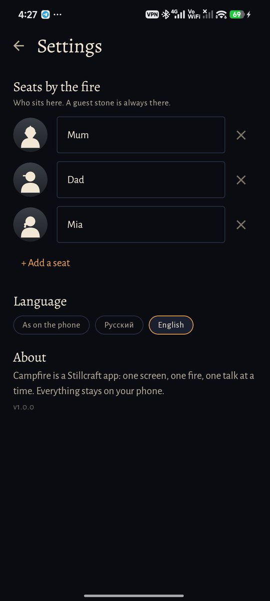
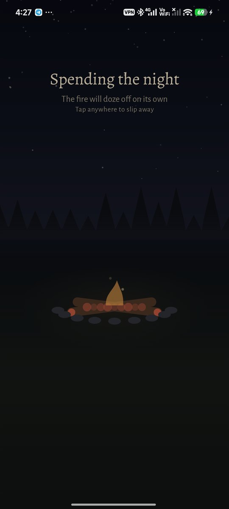

<div align="center">



# Campfire

### A talk by the fire with the people close to you.

*One screen, one fire, one phone for everyone around it. Hold your stones together and the fire lights; tap it and a spark brings a question; write one word for the day into the ash and cover the fire together. For a parent and a child, a couple, friends, the whole family — anyone who wants a quarter of an hour of real talk and to keep it. Free, no ads, no account, no internet permission.*

[](https://github.com/bigdevwhale/campfire/actions/workflows/android.yml)
[](https://github.com/bigdevwhale/campfire/releases/latest)


[](LICENSE)

**English** · [Русский](README.ru.md) · [Changelog](CHANGELOG.md)


   

</div>

---

## How an evening goes

1. **Light it together.** Everyone who sits by the fire has a stone with their name and a drawn head. Two or more people hold their stones at the same time and the fire lights — it never starts for one pair of hands. A guest stone is always there for whoever drops in.
2. **Ask the fire.** Tap the fire and a spark rises with a question. While the fire burns bright, the questions are light and funny (*if you had a tail — what would it be like?*). As the logs burn down, they come closer (*what did you leave unsaid today?*). And the embers ask about the quietest things (*what is your quietest wish right now?*). Each question costs a log, so the evening is as long as the talk.
3. **Hand over the branch.** Tap someone's stone and the burning branch goes to them: now they answer.
4. **One word in the ash.** When the logs are spent, write one word for the day into the ash.
5. **Cover it together.** Two palms over the fire put it out. The evening goes into the box as a ticket.

If you go quiet, the fire settles by itself — a log every few minutes — and goes out on its own; the evening is still kept.

## What else

| | |
|---|---|
| 🔥 **The ember for tomorrow** | Covering the fire sets one sealed ember aside. It opens only the next day, and only when you light the fire together again — the first spark of that evening. |
| 🎟 **The box** | A ticket for every evening: the date, who sat by the fire, the word in the ash, the questions. Pick a person to see only your evenings with them and the line of words you wrote together. |
| 🌙 **The fire remembers** | About a year after an evening, the fire brings its word back. |
| 📼 **The cassette** | Lay it by the fire before lighting and the evening is recorded; the reels turn so everyone can see, and the flames sway with the voices. Never on by default, never remembered between evenings. |
| 🛏 **Spending the night** | Low embers as a night-light that fade out on their own. |

96 questions in English and Russian, drawn without repeats until a stage is spent. The fire, the stones and the people on them are drawn in code.

## Privacy

No account, no cloud, no analytics and no internet permission. The microphone is used only when you lay the cassette by the fire; recordings stay in the app's own folder.

## Screenshots

        

## Building

```
./gradlew assembleDebug                 # app.campfire.dev
./gradlew assembleDebug -Pdemo          # app.campfire.demo: a family and a box of evenings
./gradlew assembleDebug -Pdemo -Pshots  # app.campfire.shots: a still fire for tools/capture.sh
```

## License

MIT
