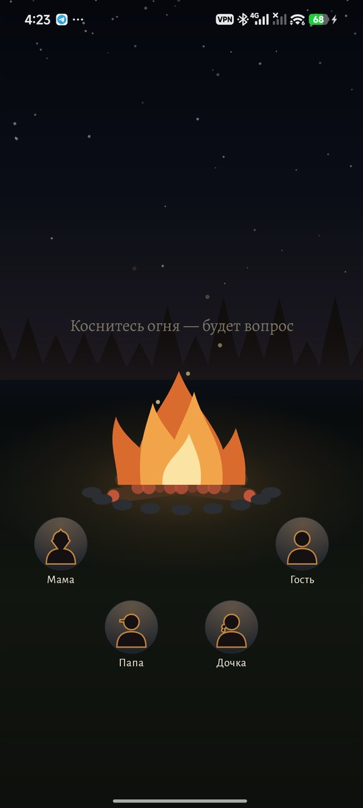
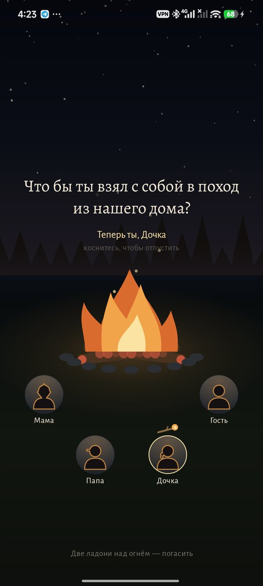
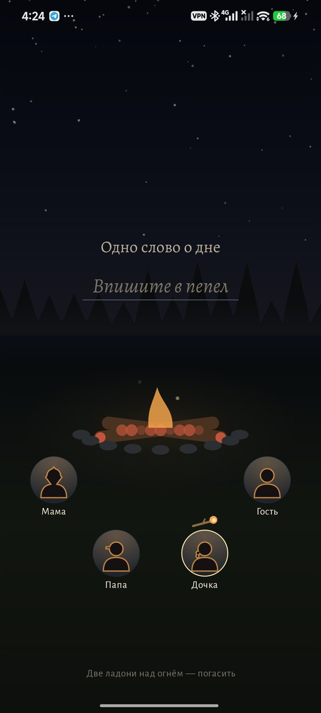
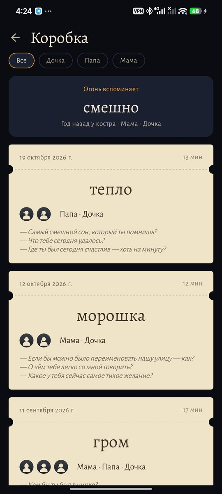
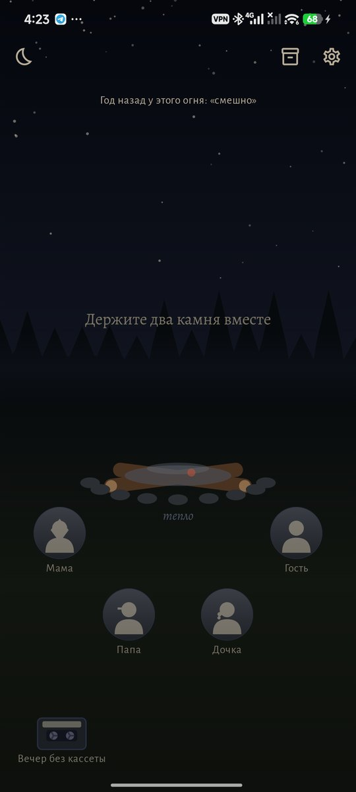
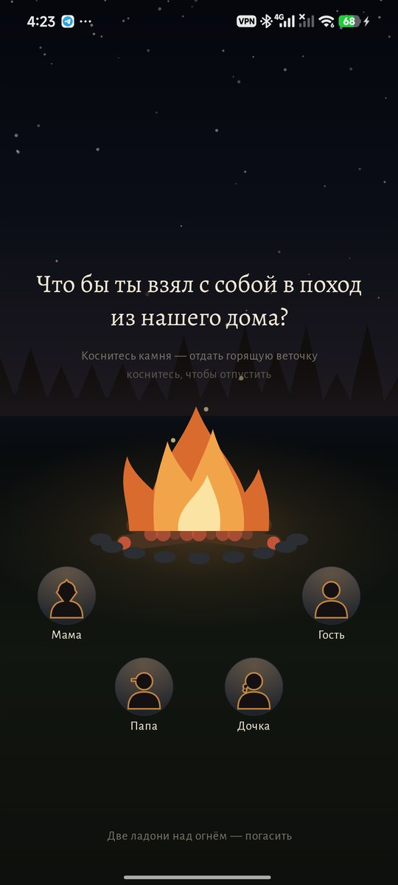
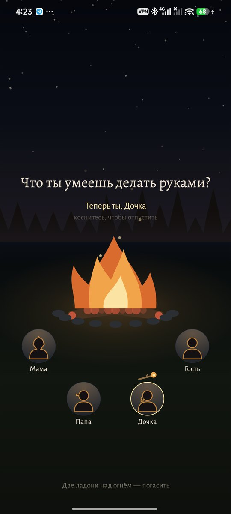
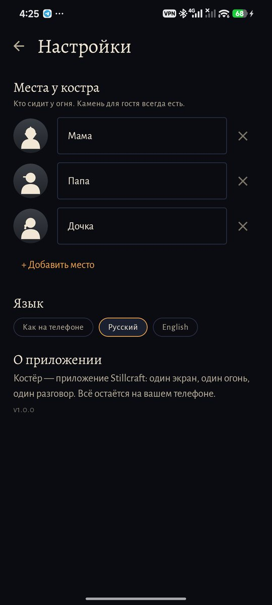
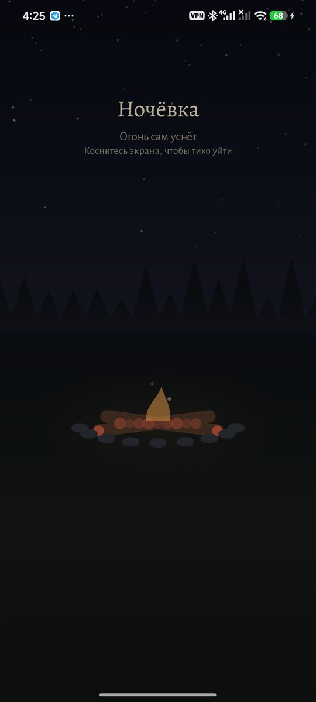

# Костёр

### Разговор у огня с близкими.

*Один экран, один огонь, один телефон на всех у костра. Держите свои камни вместе — и огонь загорается; коснитесь его — искра принесёт вопрос; впишите в пепел одно слово о дне и накройте огонь вместе. Для родителя и ребёнка, пары, друзей, всей семьи — для всех, кому хочется четверть часа настоящего разговора и сохранить его. Бесплатно, без рекламы, без аккаунта, без доступа в интернет.*

[English](README.md) · **Русский** · [Изменения](CHANGELOG.md)

   

---

## Как проходит вечер

1. **Зажгите вместе.** У каждого, кто сидит у огня, свой камень с именем и нарисованной головой. Двое или больше держат свои камни одновременно — и огонь загорается; от одной пары рук он не горит. Камень для гостя есть всегда.
2. **Спросите у огня.** Коснитесь огня — искра поднимется с вопросом. Пока пламя буйное, вопросы игривые (*если бы у тебя был хвост — какой?*), когда дрова прогорают — ближе (*что ты сегодня не сказал вслух?*), а угли спрашивают самое тихое (*какое у тебя сейчас самое тихое желание?*). Каждый вопрос — полено, так что вечер длится, пока идёт разговор.
3. **Отдайте веточку.** Коснитесь чужого камня — горящая веточка перейдёт к нему: теперь отвечает он.
4. **Одно слово в пепле.** Когда дрова прогорят, впишите в пепел одно слово о дне.
5. **Накройте вместе.** Две ладони над огнём гасят его. Вечер ложится в коробку билетом.

Если вы замолчали, огонь оседает сам — по полену в несколько минут — и гаснет; вечер всё равно сохранится.

## Что ещё

| | |
|---|---|
| 🔥 **Уголёк на завтра** | Накрывая огонь, вы откладываете запечатанный уголёк. Он откроется только на следующий день и только когда вы снова зажжёте огонь вместе — первой искрой вечера. |
| 🎟 **Коробка** | Билет на каждый вечер: дата, кто сидел у огня, слово в пепле, вопросы. Выберите человека — останутся только ваши с ним вечера и цепочка ваших слов. |
| 🌙 **Огонь вспоминает** | Примерно через год огонь возвращает слово того вечера. |
| 📼 **Кассета** | Положите её у костра перед зажиганием — вечер запишется; бобины крутятся у всех на виду, а пламя колышется в такт голосам. Никогда не включена сама и не запоминается между вечерами. |
| 🛏 **Ночёвка** | Тихие угли как ночник, которые гаснут сами. |

96 вопросов на русском и английском, без повторов, пока не исчерпана стадия. Огонь, камни и люди на них нарисованы в коде.

## Приватность

Без аккаунта, облака, аналитики и доступа в интернет. Микрофон работает, только когда кассета лежит у костра; записи остаются в папке приложения.

## Скриншоты

        

## Лицензия

MIT
